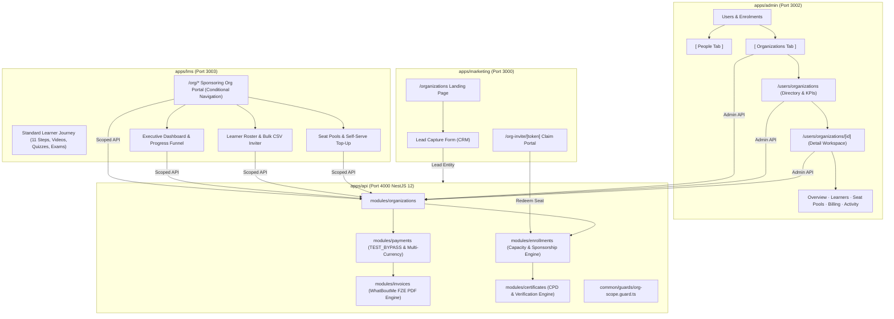
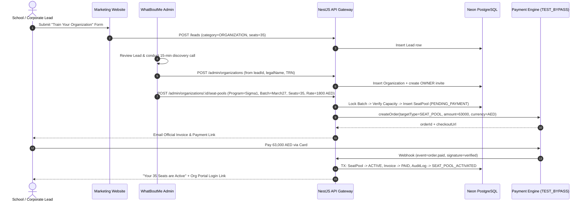
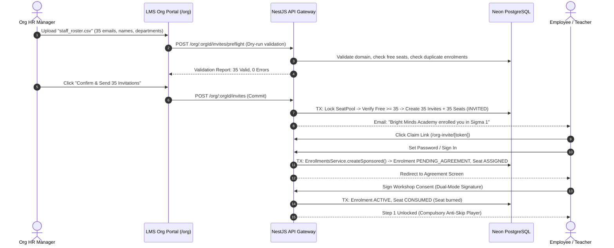

# WhatBoutMe LMS — Organizations & B2B Seat Licensing
## Authoritative Master Specification & Architecture Blueprint

> **Document Version:** 2.0 (Audio-Verified Audit & Production-Ready Engineering Blueprint)  
> **Status:** Canonical & Active. Master Blueprint for Autonomous Agent Implementation.  
> **Scope:** `apps/api`, `apps/admin`, `apps/lms`, `apps/marketing`, `apps/api/prisma/schema.prisma`  
> **Authoritative Root Standard:** Extends `AGENTS.md` (Strict server-side RBAC, immutable Audit Logging, `TEST_BYPASS` multi-currency payment abstraction, UTC timestamps, 0 TypeScript errors).

---

## 0. Executive Brief & Commercial Foundation

The **Organizations Engine** enables B2B institutional partnerships (schools, universities, hospital networks, mental health clinics, corporate HR/L&D teams, and wellness academies) to purchase **bulk seat licensing** for WhatBoutMe accredited brain-health and resilience programs.

### The Core Operating Model
1. **Wholesale Purchase**: An Organization buys a block of seats (e.g., 30 seats for *"Sigma 1 — March 2027 Cohort"* at AED 1,800/seat = AED 54,000 total) and pays WhatBoutMe upfront (or via approved Net-30 institutional invoice).
2. **Distribution & Monetization**: The organization holds legal distribution rights for those seats. They may sponsor their employees (corporate training), include it in university tuition, or independently resell seats to their own clients/patients at their own retail markup outside WhatBoutMe.
3. **WhatBoutMe Retains Complete Academic Authority**: WhatBoutMe **exclusively** hosts, grades, monitors, conducts live sessions, and issues certificates. Organizations **cannot** modify curriculum, bypass step gates, alter quiz/exam scores, or self-issue certificates.
4. **Institutional Visibility**: The organization's HR/training leads receive a dedicated **Org Portal** to invite learners (single or bulk CSV), monitor cohort progression, track completion percentages, detect inactive/at-risk learners, and download compliance reports.

---

## 1. Real-World Business Scenarios (12 Exhaustive Industry Cases)

| ID | Industry / Client | Real-World Scenario | System Execution & Architecture Flow |
|---|---|---|---|
| **S1** | **Private School Network (Dubai, UAE)** | *"Bright Minds Academy"* wants to train 35 primary school teachers in neuroscience-backed emotional resilience before the fall term begins. | School submits enquiry via `/organizations` → Lead created (`ORGANIZATION`) → Roweena conducts 15-min discovery call → Staff creates Organization + SeatPool (35 seats @ AED 1,800) → Payment link sent → School pays via card (`TEST_BYPASS`) → FZE Tax Invoice generated with school TRN → School Admin invites 35 teachers. |
| **S2** | **Mental Health Clinic & Reseller (London / Global)** | A clinic director purchases 50 seats in *"Sigma 1 Practitioner"* at wholesale ($450/seat) and resells them to outpatient clients as part of a $1,200 holistic recovery package. | The clinic collects $1,200 from each patient privately. In the Org Portal, the clinic admin inputs patient emails. Each patient receives an invite, creates an account, signs WhatBoutMe's mandatory workshop consent, and starts Step 1. The clinic tracks patient lesson completion to coordinate weekly therapy sessions. |
| **S3** | **Multinational Corporate HR (Enterprise PO / Net-30)** | A corporate enterprise orders 100 seats for executive burnout prevention. Corporate policy forbids credit cards; payment requires a Formal Purchase Order (PO-98421) and Net-30 bank transfer. | Admin creates SeatPool with `paymentMethod: INVOICE_OFFLINE`, `purchaseOrderNumber: "PO-98421"`, and `status: ACTIVE_UNPAID` (approved under corporate credit limit). Official PDF invoice with WhatBoutMe FZE bank coordinates (IBAN) is issued. 100 seats unlock immediately so the cohort can start. Once wire arrives, admin records payment reference and transitions pool to `ACTIVE`. |
| **S4** | **Employee Turnover (Revoking Unstarted Seat)** | A hospital enrolls 20 nurses. 3 days after invite issuance, 1 nurse resigns before ever accepting the invite or opening the LMS. | In Org Portal, HR clicks **Revoke Invite**. The system validates that `Seat.status === 'INVITED'` and no content was consumed. The invite is invalidated, the seat is returned to the pool (`availableSeats` increments by 1), and HR re-invites the replacement nurse without paying extra fees. |
| **S5** | **Employee Drop-Out / Goodwill Reclaim** | A teacher signs the agreement, watches Step 1 & 2, and then takes sudden emergency leave. School requests to transfer the seat to another teacher. | Org admin cannot self-revoke because the seat is `CONSUMED`. Org contacts WhatBoutMe support. A WhatBoutMe `ADMIN` evaluates the case and executes an **Admin Goodwill Seat Reclaim** with mandatory reason string ("Emergency teacher replacement approved by Roweena"). Enrolment transitions to `REVOKED`, seat resets to `INVITED`, and an immutable `AuditLog` (`SEAT_RECLAIMED`) is generated. |
| **S6** | **Bulk CSV Staff Onboarding (150 Teachers)** | A university department uploads a CSV with 150 staff members across 3 departments ("Sciences", "Humanities", "Administration"). | Org Portal provides preflight CSV dry-run parser: validates email syntax, detects existing platform users, flags duplicates, verifies corporate domain (`@brightminds.ae`), and checks pool capacity. System executes batch transaction, provisions 150 `Seat` rows, tags each with department metadata, and queues 150 welcome emails via BullMQ queue. |
| **S7** | **Self-Serve Seat Top-Up** | A coaching center has used 28 of its 30 seats. 10 new clients register unexpectedly. | Org Owner clicks **Buy More Seats** in Org Portal → Selects 10 seats for active batch → System checks real-time batch capacity (ensuring total batch capacity is not breached) → Auto-applies volume tier pricing → Checkout modal displays → Instant payment confirmation → 10 seats immediately added to active pool. |
| **S8** | **Certificate Co-Branding & Verification** | Corporate HR requires certificates to acknowledge organizational sponsorship for internal CPD compliance. | Org setting `showSponsorOnCertificate` enabled. When a sponsored learner passes the final exam, WhatBoutMe issues the certificate with immutable text: *"Accredited by WhatBoutMe · Sponsored by Bright Minds Academy"*. The QR code and public verify page (`/verify/[certId]`) display WhatBoutMe's official stamp alongside the verified sponsoring entity. |
| **S9** | **Progress Reporting for Board Review** | HR Director must present completion metrics to the Board of Directors at month-end. | Org Portal provides 1-click **Export Executive Compliance Summary (PDF/CSV)**: aggregates completion rate (82%), average exam score (88.4%), CPD hours delivered, inactive learners list, and certificate verification links. |
| **S10** | **Automated Inactivity Dunning ("At-Risk" Nudge)** | 6 corporate learners stop logging in during Step 4. | The system automatically tags learners inactive for > 14 days as `AT_RISK`. In the Org Portal, HR clicks **Nudge Inactive Learners** → Queues a branded email: *"Your team at Bright Minds is rooting for you! Continue your resilience journey in Step 4."* |
| **S11** | **Existing Personal User Invited to Corporate Seat** | An employee already registered with `sarah@gmail.com` is invited by her employer to `sarah@brightminds.ae`. | System allows seamless invite redemption: learner can either accept under her work email, or link her work sponsorship to her existing profile, avoiding dual-account confusion while preserving corporate progress tracking. |
| **S12** | **Batch Capacity Protection (Over-Subscription Guard)** | A cohort has 40 total seats with 25 already booked by the public. An organization attempts to purchase 20 seats. | Database row-level lock evaluates: `batch.capacity (40) - occupied (25) = 15 available`. System strictly rejects purchasing 20 seats with a descriptive alert: *"Only 15 seats available in this cohort. Would you like 15 in this cohort and 5 in the next cohort, or a dedicated private cohort?"* |

---

## 2. Business Architecture & Commercial Monetization

### 2.1 Multi-Currency Pricing & Volume Discount Tiers
Pricing is deterministic and locked at transaction time in `USD`, `AED`, or `INR`. Once a `SeatPool` is created, its unit price is immutable.

```
┌────────────────────────────────────────────────────────┐
│             STANDARD B2B VOLUME TIER SCHEDULE          │
├─────────────────┬──────────────┬──────────────┬────────┤
│ Seat Volume     │ USD / Seat   │ AED / Seat   │ INR / Seat
├─────────────────┼──────────────┼──────────────┼────────┤
│ 5 – 14 Seats    │ $450         │ AED 1,650    │ ₹37,500 │
│ 15 – 29 Seats   │ $400 (11% off)│ AED 1,470    │ ₹33,500 │
│ 30 – 49 Seats   │ $360 (20% off)│ AED 1,320    │ ₹30,000 │
│ 50+ Seats       │ $315 (30% off)│ AED 1,155    │ ₹26,250 │
└─────────────────┴──────────────┴──────────────┴────────┘
```

### 2.2 Payment Methods & Institutional Accounting
1. **Direct Card / Checkout (`ONLINE`)**: Instant activation via server-to-server webhook simulation (`TEST_BYPASS` active now, Razorpay/Stripe ready).
2. **Institutional Purchase Order (`INVOICE_OFFLINE`)**:
   - Generates official **WhatBoutMe FZE Tax Invoice** with mandatory invoice number format: `WBM-ORG-YYYY-XXXXX`.
   - Captures Organization Legal Name, Address, Tax Registration Number (UAE TRN / Indian GSTIN / VAT), and Client Purchase Order (`PO Number`).
   - Supports configurable payment terms: **Net-15**, **Net-30**, or **Net-60**.
   - Admin controls credit approval: `ACTIVE_UNPAID` allows immediate training start; auto-dunning triggers at T-7 and T+1 day overdue.
3. **Complimentary / Scholarship (`COMPLIMENTARY`)**: Staff override for philanthropic grants, VIP partnerships, or marketing pilots. Strictly requires `SUPER_ADMIN` approval and mandatory `reason` string logged in `AuditLog`.

---

## 3. Persona & RBAC Security Matrix

Organizations are governed by a **multi-tenant additive security scope** (`OrgScopeGuard`), maintaining zero breakage with global system roles (`SUPER_ADMIN`, `ADMIN`, `MANAGER`, `USER`).

```
┌─────────────────────────┬──────────────┬───────────┬────────────┬─────────────┬──────────────┐
│ Capability              │ SUPER_ADMIN  │ Org OWNER │ Org ADMIN  │ Org VIEWER  │ Org LEARNER  │
├─────────────────────────┼──────────────┼───────────┼────────────┼─────────────┼──────────────┤
│ Global System Config    │      ✓       │     ✗     │     ✗      │      ✗      │      ✗       │
│ Create/Suspend Any Org  │      ✓       │     ✗     │     ✗      │      ✗      │      ✗       │
│ Buy / Top-Up Seats      │      ✓       │     ✓     │     ✗      │      ✗      │      ✗       │
│ View Invoices & Billing │      ✓       │     ✓     │     ✗      │      ✗      │      ✗       │
│ Manage Org Team Members │      ✓       │     ✓     │     ✗      │      ✗      │      ✗       │
│ Invite / Reassign Seats │      ✓       │     ✓     │     ✓      │      ✗      │      ✗       │
│ View Learner Progress   │      ✓       │     ✓     │     ✓      │      ✓      │  Self Only   │
│ Export Compliance CSV   │      ✓       │     ✓     │     ✓      │      ✓      │      ✗       │
│ Unlock Steps / Overrides│      ✓       │     ✗     │     ✗      │      ✗      │      ✗       │
│ Issue Certificates      │      ✓       │     ✗     │     ✗      │      ✗      │      ✗       │
│ View Private Notes/Chat │      ✗ (Priv)│     ✗     │     ✗      │      ✗      │  Self Only   │
└─────────────────────────┴──────────────┴───────────┴────────────┴─────────────┴──────────────┘
```

---

## 4. End-to-End System Architecture



---

## 5. Authoritative Database Schema (Prisma Specification)

The following schema updates must be applied to `apps/api/prisma/schema.prisma`. Existing legacy `Company` table is cleanly evolved without breaking migrations.

```prisma
// =============================================================================
// ENUMS FOR ORGANIZATIONS & B2B LICENSING
// =============================================================================

enum OrganizationStatus {
  PENDING_VERIFICATION
  ACTIVE
  SUSPENDED
  ARCHIVED
}

enum OrgMemberRole {
  OWNER
  ADMIN
  VIEWER
}

enum SeatPoolStatus {
  DRAFT
  PENDING_PAYMENT
  ACTIVE
  ACTIVE_UNPAID
  EXPIRED
  CANCELLED
  REFUNDED
}

enum SeatPaymentMethod {
  ONLINE
  INVOICE_OFFLINE
  COMPLIMENTARY
}

enum SeatStatus {
  INVITED
  ASSIGNED
  CONSUMED
  REVOKED
  EXPIRED
}

enum FundingSource {
  SELF_PAID
  ORG_SPONSORED
  ADMIN_COMP
}

// =============================================================================
// ORGANIZATION MODELS
// =============================================================================

model Organization {
  id                 String             @id @default(uuid())
  name               String
  slug               String             @unique
  legalName          String?
  orgType            String?            // "SCHOOL" | "CLINIC" | "CORPORATE" | "NGO" | "ACADEMY" | "OTHER"
  logoUrl            String?
  website            String?
  country            String?
  timezone           String?            @default("UTC")
  status             OrganizationStatus @default(PENDING_VERIFICATION)

  // Institutional Billing & Tax Profile (WhatBoutMe FZE Invoicing)
  billingEmail       String
  billingPhone       String?
  billingAddress     Json?              // { street, city, state, postalCode, country }
  taxId              String?            // UAE TRN, Indian GSTIN, VAT, or EIN
  defaultCurrency    CurrencyCode       @default(USD)
  creditLimit        Float?             @default(0)
  paymentTermsDays   Int?               @default(30) // Net-15, Net-30, Net-60

  // Co-Branding & Privacy Toggles
  showSponsorOnCertificate Boolean      @default(false)
  sponsorDisplayName       String?      // Custom line: "Sponsored by Bright Minds Academy"
  allowedEmailDomains      String[]     @default([]) // e.g. ["@brightminds.ae"]
  shareExamScores          Boolean      @default(true) // If false, org sees pass/fail only

  // Internal Management & CRM Traceability
  sourceLeadId       String?            @unique
  accountManagerId   String?
  accountManager     User?              @relation("OrgAccountManager", fields: [accountManagerId], references: [id], onDelete: SetNull)

  // Relational Integrity
  members            OrganizationMember[]
  seatPools          SeatPool[]
  enrolments         Enrolment[]
  invites            OrganizationInvite[]
  invoices           Invoice[]

  suspendedAt        DateTime?
  suspendedReason    String?
  deletedAt          DateTime?
  createdAt          DateTime           @default(now())
  updatedAt          DateTime           @updatedAt

  @@index([status])
  @@index([createdAt(sort: Desc)])
  @@index([accountManagerId])
}

model OrganizationMember {
  id             String        @id @default(uuid())
  organizationId String
  organization   Organization  @relation(fields: [organizationId], references: [id], onDelete: Cascade)
  userId         String
  user           User          @relation("UserOrgMemberships", fields: [userId], references: [id], onDelete: Cascade)
  role           OrgMemberRole @default(ADMIN)
  department     String?
  invitedById    String?
  joinedAt       DateTime      @default(now())
  removedAt      DateTime?

  createdAt      DateTime      @default(now())
  updatedAt      DateTime      @updatedAt

  @@unique([organizationId, userId])
  @@index([userId])
  @@index([organizationId, role])
}

model SeatPool {
  id                  String            @id @default(uuid())
  reference           String            @unique // e.g., "SP-2027-0042"
  organizationId      String
  organization        Organization      @relation(fields: [organizationId], references: [id], onDelete: Restrict)
  programId           String
  program             Program           @relation(fields: [programId], references: [id], onDelete: Restrict)
  batchId             String?           // Nullable: floating program seats vs cohort-locked seats
  batch               Batch?            @relation(fields: [batchId], references: [id], onDelete: SetNull)

  totalSeats          Int
  unitPrice           Float             // Locked price per seat at checkout
  currency            CurrencyCode
  discountPercent     Float?            @default(0)
  totalAmount         Float             // totalSeats * unitPrice * (1 - discountPercent/100)
  paymentMethod       SeatPaymentMethod @default(ONLINE)
  status              SeatPoolStatus    @default(DRAFT)

  // Institutional PO & Terms
  purchaseOrderNumber String?
  paymentTermsDays    Int?
  paymentDueDate      DateTime?

  paidAt              DateTime?
  expiresAt           DateTime?         // Unassigned seats expire after this date (default 12 mos)
  createdById         String
  createdBy           User              @relation("CreatedSeatPools", fields: [createdById], references: [id])
  notes               String?

  seats               Seat[]
  payments            Payment[]
  invoices            Invoice[]

  version             Int               @default(0) // Optimistic concurrency lock
  createdAt           DateTime          @default(now())
  updatedAt           DateTime          @updatedAt

  @@index([organizationId, status])
  @@index([batchId, status])
  @@index([programId])
  @@index([status, paymentDueDate])
}

model Seat {
  id            String              @id @default(uuid())
  seatPoolId    String
  seatPool      SeatPool            @relation(fields: [seatPoolId], references: [id], onDelete: Cascade)
  status        SeatStatus          @default(INVITED)

  inviteId      String?             @unique
  invite        OrganizationInvite? @relation(fields: [inviteId], references: [id], onDelete: SetNull)

  userId        String?
  user          User?               @relation("UserAllocatedSeats", fields: [userId], references: [id], onDelete: SetNull)

  enrolmentId   String?             @unique
  enrolment     Enrolment?          @relation(fields: [enrolmentId], references: [id], onDelete: SetNull)

  department    String?             // e.g., "Grade 5 Staff", "Neurology Dept"
  assignedAt    DateTime?
  consumedAt    DateTime?           // Set when learner signs agreement (content unlocked)
  revokedAt     DateTime?
  revokedReason String?

  createdAt     DateTime            @default(now())
  updatedAt     DateTime            @updatedAt

  @@index([seatPoolId, status])
  @@index([userId])
}

model OrganizationInvite {
  id             String       @id @default(uuid())
  organizationId String
  organization   Organization @relation(fields: [organizationId], references: [id], onDelete: Cascade)
  seatPoolId     String
  email          String       // Normalized lower-case
  fullName       String?
  department     String?
  tokenHash      String       @unique // SHA-256 of raw secret token sent in email link
  expiresAt      DateTime     // Default 14 days
  acceptedAt     DateTime?
  cancelledAt    DateTime?
  resendCount    Int          @default(0)
  lastSentAt     DateTime?    @default(now())

  seat           Seat?

  createdAt      DateTime     @default(now())
  updatedAt      DateTime     @updatedAt

  @@index([organizationId, email])
  @@index([seatPoolId])
  @@index([tokenHash])
}

// =============================================================================
// MODIFICATIONS TO EXISTING CORE MODELS
// =============================================================================

// Extend Enrolment model:
// Add:
//   fundingSource   FundingSource  @default(SELF_PAID)
//   organizationId  String?
//   organization    Organization?  @relation(fields: [organizationId], references: [id], onDelete: SetNull)
//   seat            Seat?

// Extend Payment model:
// Add:
//   seatPoolId      String?
//   seatPool        SeatPool?      @relation(fields: [seatPoolId], references: [id], onDelete: SetNull)

// Extend Invoice model:
// Add:
//   seatPoolId      String?
//   seatPool        SeatPool?      @relation(fields: [seatPoolId], references: [id], onDelete: SetNull)
//   organizationId  String?
//   organization    Organization?  @relation(fields: [organizationId], references: [id], onDelete: SetNull)
//   poNumber        String?

// Extend Lead model:
// Add:
//   organizationName String?
//   expectedSeats    Int?

// Extend User model:
// Add:
//   orgMemberships   OrganizationMember[] @relation("UserOrgMemberships")
//   managedOrgs      Organization[]       @relation("OrgAccountManager")
//   createdSeatPools SeatPool[]           @relation("CreatedSeatPools")
//   allocatedSeats   Seat[]               @relation("UserAllocatedSeats")
```

---

## 6. Finite State Machines & Lifecycle Invariants

### 6.1 SeatPool Finite State Machine
```
               [ DRAFT ]
                   │
         ┌─────────┴─────────┐
         │ (Online Checkout) │ (Net-30 PO Approved)
         ▼                   ▼
[ PENDING_PAYMENT ]    [ ACTIVE_UNPAID ]
         │                   │
         │ (Webhook PAID)    │ (Wire Received)
         ▼                   ▼
    [ ACTIVE ] ◄─────────────┘
         │
    ┌────┴────────────────────────┬──────────────────────┐
    ▼                             ▼                      ▼
[ EXPIRED ] (12mo cutoff)   [ REFUNDED ] (Credit Note) [ CANCELLED ]
```

### 6.2 Seat Lifecycle & Consumption Invariant
```
            [ 1. INVITED ] ──(Invite sent, seat reserved from pool)
                   │
                   ├──► (Invite cancelled/expired before acceptance) ──► [ REVOKED ] (Seat returns to pool)
                   │
                   ▼
            [ 2. ASSIGNED ] ──(Learner accepts invite, account provisioned, Enrolment PENDING_AGREEMENT)
                   │
                   ├──► (Learner declines or HR cancels before signing) ──► [ REVOKED ] (Seat returns to pool)
                   │
                   ▼
            [ 3. CONSUMED ] ──(Learner signs Agreement, Step 1 unlocked, hard content delivery started)
                   │
                   └──► (CANNOT BE REVOKED BY ORG; Admin Goodwill Reclaim ONLY with Audit Log)
```

**The Immutable Seat Invariant**:
$$\text{Total Purchased Seats} = \text{Available Unassigned} + \text{Invited (Pending)} + \text{Assigned (Pre-Agreement)} + \text{Consumed (In Training)} + \text{Expired Unused}$$

---

## 7. Interaction Sequence Diagrams

### 7.1 Sales-Assisted Institutional Onboarding & Checkout


### 7.2 Bulk CSV Learner Inviting & Enrolment Flow


---

## 8. Complete NestJS API Specification (`apps/api/src/modules/organizations`)

### 8.1 Module Directory Structure
```
apps/api/src/modules/organizations/
├── organizations.module.ts
├── admin-organizations.controller.ts      # Staff endpoints (/admin/organizations/**)
├── org-portal.controller.ts               # Sponsoring client endpoints (/org/:orgId/**)
├── org-invites.controller.ts              # Public & claim endpoints (/org-invites/**)
├── organizations.service.ts               # Org lifecycle, profiles, members
├── seat-pools.service.ts                  # Pools, pricing tiers, batch reservations
├── seats.service.ts                       # Invites, claims, revokes, reclaims
├── org-reporting.service.ts               # Analytics, KPIs, compliance CSV
├── guards/
│   ├── org-scope.guard.ts                 # Scoped multi-tenant RBAC
│   └── org-role.guard.ts                  # OWNER vs ADMIN vs VIEWER
├── dto/
│   ├── create-organization.dto.ts
│   ├── update-organization.dto.ts
│   ├── create-seat-pool.dto.ts
│   ├── bulk-invite.dto.ts
│   └── query-org-learners.dto.ts
└── __tests__/
    ├── seat-pools-concurrency.spec.ts
    ├── seats-lifecycle.spec.ts
    └── org-scope-guard.spec.ts
```

### 8.2 Endpoints Roster & Permission Contracts

#### A. Admin Control Plane (`/admin/organizations`)
- `GET /admin/organizations` — Paginated directory, search, status filter, multi-currency revenue KPIs. (`ADMIN`, `SUPER_ADMIN`)
- `POST /admin/organizations` — Provision new organization from Lead or cold enterprise deal.
- `GET /admin/organizations/:id` — Full workspace detail: Profile, Seats, Learners, Pools, Billing, Team, Audit Logs.
- `PATCH /admin/organizations/:id` — Update legal profile, billing terms, taxId, allowed domains, certificate toggles.
- `POST /admin/organizations/:id/suspend` — Suspend access for non-payment or breach. Requires `reason`.
- `POST /admin/organizations/:id/reactivate` — Restore suspended organization.
- `POST /admin/organizations/:id/seat-pools` — Authorize a new seat pool (Online, Invoice Net-30, Complimentary).
- `POST /admin/seat-pools/:id/mark-paid` — Manual bank transfer reconciliation. Requires reference string and `reason`.
- `POST /admin/seat-pools/:id/refund` — Issue partial/full credit note on unconsumed seats. Triggers `REFUND_ISSUED` audit.
- `POST /admin/seats/:id/reclaim` — Goodwill override to reclaim a `CONSUMED` seat. Strictly audited.

#### B. Sponsoring Client Portal Plane (`/org/:orgId`) — Guarded by `OrgScopeGuard`
- `GET /org/me` — List all organizations the authenticated user belongs to (multi-org switcher).
- `GET /org/:orgId/overview` — Executive KPI tiles, stage funnel chart, seat utilization donut. (`VIEWER`+)
- `GET /org/:orgId/learners` — Comprehensive progress roster: Learner name, department, stage, progress %, last active, exam score, certificate link. (`VIEWER`+)
- `GET /org/:orgId/learners/export` — Streamed CSV compliance download. (`VIEWER`+)
- `POST /org/:orgId/invites/preflight` — Dry-run CSV validation engine. (`ADMIN`+)
- `POST /org/:orgId/invites` — Commit bulk invites and allocate seats. (`ADMIN`+)
- `POST /org/:orgId/invites/:inviteId/resend` — Resend activation invitation email. (`ADMIN`+)
- `POST /org/:orgId/seats/:seatId/revoke` — Revoke unstarted seat and return to pool. (`ADMIN`+)
- `POST /org/:orgId/nudge-inactive` — Send automated progress encouragement to inactive learners. (`ADMIN`+)
- `POST /org/:orgId/seat-pools/quote` — Real-time price calculation for self-serve top-up. (`OWNER`)
- `POST /org/:orgId/seat-pools/purchase` — Initiate `TEST_BYPASS` checkout for extra seats. (`OWNER`)
- `GET /org/:orgId/billing` — Invoice repository and PDF downloads. (`OWNER`)
- `CRUD /org/:orgId/members` — Manage HR team permissions (`OWNER`, `ADMIN`, `VIEWER`). (`OWNER`)

#### C. Public & Learner Claim Plane (`/org-invites`)
- `GET /org-invites/:token` — Resolve invite metadata (Organization name, logo, program title, masked email). Throttled.
- `POST /org-invites/:token/accept` — Authenticated claim: transitions seat to `ASSIGNED`, creates `Enrolment`.

---

## 9. Privacy, GDPR & Educational Sovereignty

1. **Explicit Sponsoring Consent**: During invite claim and inside the Digital Agreement step, the learner is presented with an un-bypassable disclosure:  
   > *"Your enrollment is sponsored by **Bright Minds Academy**. By proceeding, you consent to sharing your module completion progress, stage milestones, final examination score, and certificate issuance status with your sponsoring organization. Sponsoring administrators cannot view your private reflective notes, community chat messages, or personal mission statements."*
2. **Strict Field-Level Isolation**:
   - `StudentNote` records are strictly scoped to `userId` and never joined or exposed to org queries.
   - `Message` (chat) records are strictly private.
   - `MissionStatementSubmission` raw text is private; only the milestone timestamp (`missionStatementApprovedAt`) is visible to the org.
   - If `shareExamScores === false`, the org only sees `PASSED` / `IN_PROGRESS` / `FAILED`, never numeric percentage marks.
3. **Permanent Academic Ownership**: If an employee leaves the sponsoring organization, the earned **Certificate and CPD hours remain with the individual human permanently**. The organization cannot delete, re-assign, or revoke an already earned credential.

---

## 10. Front-End UI/UX Implementation Specifications

### 10.1 Admin Portal: Users & Enrolments Sub-Navigation (`apps/admin`)
In `apps/admin/app/users/page.tsx`, introduce a clean, top-level segmented view switch directly under the header:

```tsx
<div className={styles.topSegmentedControl}>
  <Link href="/users" className={`${styles.segmentBtn} ${!isOrgView ? styles.segmentBtnActive : ""}`}>
    <Icons.Users width={15} height={15} />
    <span>People (Learners & Staff)</span>
  </Link>
  <Link href="/users/organizations" className={`${styles.segmentBtn} ${isOrgView ? styles.segmentBtnActive : ""}`}>
    <Icons.Building width={15} height={15} />
    <span>Organizations (B2B Licensing)</span>
  </Link>
</div>
```

#### New Admin Pages
1. `apps/admin/app/users/organizations/page.tsx`:
   - **Executive KPI Strip**: Total Organizations · Active Cohorts · Total Seats Sold · Utilization % · Outstanding Net-30 Invoices.
   - **Data Table**: Organization Name & Logo, Country, Status (`StatusBadge`), Assigned Programs, Seat Bar (`28/30 Used`), Certified Count, Account Manager.
   - **Action Bar**: Search, Country filter, Status filter, "+ New Organization" modal trigger, "Export Organizations CSV".
2. `apps/admin/app/users/organizations/[id]/page.tsx`:
   - Tabbed layout: **Overview**, **Learners (35)**, **Seat Pools (2)**, **Pending Invites (4)**, **Billing & Invoices**, **Team Members**, **Audit Trail**.
   - Reuses standard UI components: `Modal`, `ConfirmDialog`, `InputDialog`, `CustomSelect`, `StatusBadge`, `Toast`.

### 10.2 LMS Org Portal (`apps/lms/app/org`)
Integrated directly into the Next.js LMS application, sharing authentication, session cookies, and responsive styling.

- **Dynamic Navigation Link**: The LMS sidebar displays **"Organization Portal"** only if `user.orgMemberships.length > 0`.
- **Pages**:
  - `/org`: High-level dashboard, seat capacity donut chart, milestone funnel (Step 1-11 $\rightarrow$ Exam $\rightarrow$ Live Attendance $\rightarrow$ 1-on-1 $\rightarrow$ Certified), and at-risk learner alert cards.
  - `/org/learners`: Searchable table with filters by Department, Program, and Milestone Stage. 1-click CSV export.
  - `/org/invite`: Dual mode: Manual single invite OR Drag-and-Drop CSV uploader with live dry-run error table.
  - `/org/seats`: Active pools, expiry warnings, and "+ Buy More Seats" self-serve modal.
  - `/org/billing`: Historical invoices with instant PDF download.
  - `/org/settings`: Organization profile, allowed email domains, and certificate co-branding toggles.

### 10.3 Marketing Website (`apps/marketing`)
- `/organizations`: B2B landing page featuring institutional value proposition, video overview, interactive volume pricing calculator, enterprise FAQ accordion, and lead capture form.
- `/org-invite/[token]`: Branded redemption page. Displays the sponsoring organization's logo and welcome message.

---

## 11. 45 Battle-Tested Edge Cases (Exhaustive Technical Matrix)

| ID | Edge Case Scenario | Trigger Event | Technical Handling & Database Action | User-Facing Result / Error Message | Audit Action |
|---|---|---|---|---|---|
| **E1** | **Race Condition on Last Free Seat** | Two HR admins click "Invite" simultaneously when only 1 seat remains in the pool. | Database transaction executes `SELECT ... FROM "SeatPool" WHERE id = :id FOR UPDATE`. First transaction reserves the seat; second transaction detects `availableSeats == 0` and rolls back. | First admin succeeds: *"Invitation sent"*. Second admin receives: *"Seat allocation failed: no remaining seats in this pool. Please top-up."* (HTTP 409). | `SEAT_INVITED` (x1) |
| **E2** | **Already Enrolled Learner (Self-Paid)** | HR invites an employee who already purchased the program privately. | System detects existing `Enrolment` where `userId == targetUser.id AND programId == pool.programId`. Invite creation preflight flags the conflict. | *"Learner is already enrolled in this program independently. Seat not consumed."* | None |
| **E3** | **Dual Corporate Sponsorship Conflict** | Org B attempts to sponsor a learner currently enrolled under Org A for the same course. | Program-level uniqueness constraint (`@@unique([userId, programId])`) prevents dual active enrolments. | *"Learner is already actively sponsored by another organization for this program."* | None |
| **E4** | **CSV Formatting & Case Anomalies** | CSV contains mixed casing (`John.DOE@Company.COM`), leading spaces, and duplicates. | Preflight normalizes emails via `.trim().toLowerCase()`. Deduplicates in-memory. Identifies duplicate rows and flags them in preview. | Live preview highlights duplicates: *"Row 4 duplicate of Row 2: Skipped"*. | None |
| **E5** | **Invite Forwarding / Identity Hijacking** | Employee A forwards their invite link to Employee B. | Claim endpoint checks `tokenHash`. If Employee B logs in with `empB@company.com`, system validates against `invite.email`. | *"This invitation is designated exclusively for empA@company.com. Please log in with the invited email address."* (HTTP 403). | None |
| **E6** | **Expired Unclaimed Invite** | Invite sent but employee never opens it for 14 days. | Nightly BullMQ cron job evaluates `OrganizationInvite.expiresAt < NOW() AND acceptedAt IS NULL`. Updates invite to `CANCELLED`, resets seat to `INVITED`, returns seat to pool. | Org admin sees seat status change from *"Invite Sent (Expired)"* back to *"Available"*. | `SEAT_REVOKED` |
| **E7** | **Typo in Email Address** | Admin enters `johndoe@gmal.com` instead of `gmail.com`. | Admin clicks **Cancel Invite** in Org Portal. System validates `Seat.status === 'INVITED'`. Deletes invite, resets seat, restores pool balance. | Seat immediately becomes available for re-assignment. | `SEAT_REVOKED` |
| **E8** | **Reclaim Attempt After Content Delivery** | HR attempts to revoke a seat after employee completed Step 3. | API checks `Seat.status`. Since status is `CONSUMED`, self-service revocation is strictly blocked. | *"This seat has been consumed as learning materials have been accessed. Contact WhatBoutMe staff for special exemptions."* (HTTP 400). | None |
| **E9** | **Checkout Failure / Abandonment** | Org begins checkout for 20 seats but closes browser before completing payment. | SeatPool remains in `PENDING_PAYMENT` with a 7-day TTL. Batch seats are NOT permanently decremented until webhook confirms payment. | Pool displays in Admin as *"Draft / Incomplete Checkout"*. Can be retried via saved checkout link. | None |
| **E10** | **Duplicate Payment Webhook** | Payment gateway delivers `order.paid` webhook twice within 2 seconds. | Webhook handler checks `WebhookEvent` table idempotency key. Second event is logged and immediately acknowledged without double-crediting seats. | HTTP 200 returned; seat pool activated exactly once. | `SEAT_POOL_ACTIVATED` (x1) |
| **E11** | **Partial Pool Refund** | School purchased 30 seats, used 10, and requests a refund for the 20 unused seats. | Admin evaluates refund: verifies 20 seats are unassigned/unconsumed. Decrements `totalSeats` from 30 to 10. Generates FZE Credit Note (`Invoice.creditNoteId`). Issues gateway refund. | 20 unused seats deleted. Consumed 10 seats remain fully active. | `REFUND_ISSUED` |
| **E12** | **Floating Seat Assigned to Full Batch** | Org holds floating program seats and attempts to assign a learner to a cohort that reached max capacity. | Preflight checks `batch.capacity - occupiedSeats`. If `0`, assignment is rejected. | *"Selected cohort 'March 2027' is full (40/40). Please select an upcoming cohort or request batch capacity increase."* | None |
| **E13** | **Batch Capacity Reduction Conflict** | Admin edits batch capacity down to 25 when an org already holds 10 reserved seats and public holds 18. | Batch update validation evaluates: `newCapacity >= occupiedSeats + reservedOrgSeats`. Validation fails (`25 < 28`). | *"Cannot reduce capacity to 25: 18 occupied seats + 10 reserved organization seats require minimum capacity of 28."* | None |
| **E14** | **Cohort Cancellation / Rescheduling** | WhatBoutMe cancels or reschedules a batch containing 20 org learners. | Admin uses **Transfer Cohort Tool**: batch transaction transfers all 20 enrolments and the SeatPool to the new batch date. System updates Zoom meeting links and dispatches automated notices. | Org admin and all 20 learners receive branded rescheduling notifications with new calendar invites. | `BATCH_TRANSFER` |
| **E15** | **Registration Deadline Passed** | Org attempts to purchase seats for a cohort whose registration cutoff was yesterday. | API validates `batch.registrationDeadline < NOW()`. Rejects creation unless actor has `SUPER_ADMIN` / `ADMIN` override role. | *"Registration for this cohort closed on [Date]. Please select the next upcoming cohort."* | None |
| **E16** | **Pool Expiry (12 Months)** | 5 unassigned seats remain in a pool purchased 365 days ago. | BullMQ scheduler evaluates `SeatPool.expiresAt < NOW()`. Transitions pool to `EXPIRED`. Sets unassigned seats to `EXPIRED`. | Sponsoring dashboard shows *"Pool Expired"*. Learners already enrolled continue training without interruption. | `SEAT_POOL_EXPIRED` |
| **E17** | **Organization Suspension (Non-Payment)** | Net-30 invoice remains unpaid for 45 days. Admin suspends organization. | Org status updated to `SUSPENDED`. `OrgScopeGuard` blocks all Org Portal mutations and downloads. **Active learners are NOT blocked from accessing course materials.** | Org Admin receives: *"Account suspended due to outstanding invoice. Contact accounts@whatboutme.com."* Learners continue uninterrupted. | `ORG_SUSPENDED` |
| **E18** | **Organization Soft-Deletion** | Client requests account deletion under GDPR / contract end. | Sets `Organization.deletedAt = NOW()`. Enrolments, payments, and certificates are preserved for statutory financial and compliance audit retention. | Organization removed from active directories. Certificates remain publicly verifiable. | `ORG_DELETED` |
| **E19** | **Sole Org Owner Resignation** | The sole `OWNER` of an organization leaves their company without assigning a successor. | Validation rule blocks removing or downgrading the last `OWNER`. WhatBoutMe `SUPER_ADMIN` uses Admin Panel to assign a new Owner. | System prevents orphaned organizations. | `ORG_MEMBER_UPDATED` |
| **E20** | **Org Admin Takes the Course** | HR manager who manages the org also wants to earn her certification. | Allowed. The user has an `OrganizationMember` row (`ADMIN`) and a separate `Enrolment` row (`USER`). In the LMS, she toggles between Learner Dashboard and Org Portal. | Flawless persona switching without requiring two email addresses. | None |
| **E21** | **Multi-Currency Accounting Reporting** | Org has pools in both USD ($10,000) and AED (AED 36,000). | Revenue reporting aggregates and presents totals partitioned strictly by currency. The system never combines different currencies into a single sum without FX normalization. | Financial cards display: *"$10,000 USD · AED 36,000 AED"*. | None |
| **E22** | **Course Retail Price Increase** | WhatBoutMe increases course price from $450 to $550 after an org bought a pool. | The existing pool's `unitPrice` remains locked at $450. Future top-up pools reflect the new $550 price unless an admin grants a legacy discount. | Contractual pricing integrity preserved. | None |
| **E23** | **Certificate Revocation for Plagiarism** | An org learner is found to have plagiarized their final mission statement. | WhatBoutMe staff revokes certificate via existing `CERTIFICATE_STATUS_CHANGE`. Certificate becomes `REVOKED`. Verification URL displays revocation notice. Org dashboard updates to `REVOKED`. | Immediate compliance synchronization. | `CERTIFICATE_STATUS_CHANGE` |
| **E24** | **Learner Fails Final Exam Retakes** | Sponsoring learner exhausts all 3 examination attempts. | System locks exam attempts. Enrolment flags `EXAM_FAILED`. Org Portal displays status: *"Failed (3/3 attempts) · Awaiting Admin Review"*. | Org cannot self-unlock; WhatBoutMe academic integrity maintained. | None |
| **E25** | **Bulk CSV Exceeds Available Seats** | Org has 15 free seats but uploads a CSV containing 25 names. | Preflight detects `25 > 15`. Operation is blocked before any database writes occur. | *"CSV contains 25 valid names, but your pool only has 15 free seats. Please purchase 10 additional seats or select 15 learners."* | None |
| **E26** | **Restricted Email Domain Enforcement** | Org configured `allowedEmailDomains = ["@brightminds.ae"]`. HR invites `coach.john@gmail.com`. | Invite service evaluates domain suffix. Rejects invite unless overridden by an Org `OWNER`. | *"Email domain '@gmail.com' is not permitted by your organization's security policy. Allowed domains: @brightminds.ae"*. | None |
| **E27** | **IDOR / Cross-Tenant Tampering** | Malicious Org Admin alters request payload to inspect another org's learner: `GET /org/org-A/learners?orgId=org-B`. | `OrgScopeGuard` extracts `orgId` strictly from validated JWT claims and route parameters, rejecting cross-tenant identifiers with `403 Forbidden`. | Malicious access blocked. | Security Audit Log |
| **E28** | **Invite Token Brute-Force Attack** | Bot scans `/org-invites/:token` with random UUIDs. | Upstash Redis throttler limits token verification to 10 requests/min per IP. Tokens are 256-bit entropy random values stored as SHA-256 hashes. | IP throttled with HTTP 429. Database never exposed to hash collision attacks. | None |
| **E29** | **Learner GDPR Erasure** | Former employee exercises GDPR Right to Erasure on WhatBoutMe. | User profile data is anonymized (`name: "Former Learner"`, `email: "deleted-uuid@whatboutme.invalid"`). Seat record retains `status: CONSUMED` with `userId: null`. | Org seat ledger remains financially reconciled (total seats count matches); individual personal data purged. | `USER_GDPR_ERASED` |
| **E30** | **Timezone Divergence in Deadlines** | Org is in London (UTC+1), WhatBoutMe server is in UTC, cohort starts in Dubai (UTC+4). | All database dates stored in UTC. UI renders formatted wall-clock times using `apps/admin/app/lib/timezone.ts` and user's browser timezone. | Clear, localized date displays prevent missed live workshops. | None |
| **E31** | **Learner Loses Access to Corporate Email** | Employee leaves company email before completing training, requests email change. | Learner requests email update. System dispatches OTP confirmation to old AND new email, or WhatBoutMe staff manually updates with identity verification. | Learner continues under new email; historical sponsorship link preserved. | `USER_EMAIL_CHANGED` |
| **E32** | **Batch Date Shift After Invites Sent** | Trainer shifts batch start date by 1 week after 20 invites were emailed. | System dispatches batch update event. All open invite tokens remain valid and redirect to updated schedule. | No broken invite links. | `BATCH_UPDATED` |
| **E33** | **Unmatched Attendance for Org Learner** | Org learner attends Zoom session with their spouse's Zoom name ("iPad 2"). | Existing Attendance Reconciliation engine flags `UnmatchedAttendance`. Manager links record to learner. Stage 3 attendance satisfies automatically. | Org dashboard updates to *"Live Sessions Satisfied ✓"*. | `ATTENDANCE_OVERRIDE` |
| **E34** | **Learner Refuses Workshop Consent** | Sponsoring learner refuses to accept the workshop agreement and data sharing clause. | Learner cannot proceed past Step 1 gate. Enrolment remains `PENDING_AGREEMENT`. Seat remains `ASSIGNED`. Content stays locked. | Org admin sees status: *"Pending Agreement Signing"*. HR can talk to employee or revoke the seat. | None |
| **E35** | **Complimentary Pool Creation Abuse** | Compromised admin account attempts to generate 1,000 free seats. | Complimentary pool creation strictly requires `SUPER_ADMIN` role and mandatory `reason` text length $\ge 15$ characters. Rate-limited to 2 pools/day. | Blocked if role insufficient. | `AUDIT_ALERT` |
| **E36** | **Zero-Dollar Transaction on 100% Discount** | Deal structured as 100% scholarship. | Payment gateway checkout bypassed. System triggers zero-dollar internal order verification, transitioning pool directly to `ACTIVE`. | Instant activation without dummy credit card charges. | `SEAT_POOL_ACTIVATED` |
| **E37** | **Simultaneous Self-Serve Top-Up and Admin Refund** | Org Owner buys 10 seats while Admin is processing a 5-seat refund for unused seats. | Optimistic concurrency control via `version` column on `SeatPool`. Conflicting write detects version mismatch and retries transaction cleanly. | Both operations complete accurately; total seats accurately reflects `original + 10 - 5`. | `SEAT_POOL_UPDATED` |
| **E38** | **Partial Course Drop Out (Step 7 of 11)** | Employee finishes 7 steps and leaves organization. | Seat remains `CONSUMED`. Learner maintains access to their account indefinitely. Organization sees progress frozen at 63%. | Learner can self-complete later; org seat is non-refundable. | None |
| **E39** | **Special Character Injection in CSV** | CSV contains formula injection (`=cmd|' /C calc'!A0`) or SQL syntax in Name field. | Input sanitizer strips formula prefixes (`=`, `+`, `-`, `@`) and parameterized Prisma queries prevent SQL injection. | Sanitized cleanly without remote code execution. | None |
| **E40** | **Bulk Invites to Already-Registered Free Community Users** | 10 of 30 invited employees already have free accounts on WhatBoutMe. | Invite handler links the corporate sponsorship to their existing `userId` upon login. User gains immediate access to the sponsored course. | Seamless upgrade from community user to accredited learner. | `SEAT_ASSIGNED` |
| **E41** | **Invoice PDF Generation Failure** | Storage service downtime during checkout webhook execution. | BullMQ queue handles invoice PDF generation asynchronously with 5 retries. Transaction completes; invoice is rendered and emailed once storage recovers. | User sees immediate success; invoice appears within 2 minutes. | `INVOICE_GENERATED` |
| **E42** | **Session Timeout During Agreement Drawing** | Learner spends 45 minutes on agreement canvas mode; JWT expires. | Client interceptor transparently executes refresh token exchange (`POST /auth/refresh`) without resetting HTML5 canvas state. | Zero signature loss or frustrating form resets. | None |
| **E43** | **Org Renamed After Certificates Issued** | School rebrands from *"Bright Minds"* to *"Bright Minds International"*. | Organization profile updated. Future certificates print new name. Existing certificates maintain historical snapshot of sponsor name at time of issuance. | Historical legal document integrity preserved. | `ORG_UPDATED` |
| **E44** | **Learner Completes Course in Record Time** | Exceptionally fast employee finishes all 11 steps and final exam in 2 days. | System anti-skip player enforces compulsory watch verification. Once verified, exam unlocks normally. Certificate issued immediately upon passing. | Rapid progression supported; anti-cheat integrity maintained. | `CERTIFICATE_ISSUED` |
| **E45** | **Simultaneous Sponsoring & Self-Enrollment in Different Courses** | Learner is sponsored by hospital for *Sigma 1*, and independently buys *Sigma 2*. | Both enrolments coexist independently: *Sigma 1* has `fundingSource: ORG_SPONSORED` and org visibility; *Sigma 2* has `fundingSource: SELF_PAID` with zero org visibility. | Perfect privacy compartmentalization. | None |

---

## 12. Automated Notification, Dunning & Digest System

1. **Transactional Alerts**:
   - `ORGANIZATION_INVITE_SENT`: Branded invitation with single-use magic link.
   - `ORGANIZATION_SEAT_ACTIVATED`: Welcome receipt and portal onboarding link for Org Owner.
   - `ORGANIZATION_SEAT_REVOKED`: Notification to HR that a seat has returned to their pool.
2. **Automated Learner Nudges**:
   - Inactivity trigger: If `UserLessonProgress` has no updates for 14 days, automated system nudge is queued.
3. **Weekly Executive Digest**:
   - Runs every Monday at 08:00 (in Organization's configured timezone).
   - Summarizes: Seats utilized, learners progressing, certificates earned this week, and learners needing encouragement.
4. **Institutional Dunning (Net-30 POs)**:
   - T-7 Days before due date: Friendly reminder with invoice PDF attached.
   - T+1 Day overdue: Notice of payment delay sent to Billing Email and Account Manager.
   - T+14 Days overdue: Administrative warning of pending portal suspension.

---

## 13. Autonomous Coding Agent Implementation Roadmap

This roadmap is structured in 6 sequential, verifiable phases. Every phase requires `check-types` and unit test passes before proceeding.

```
┌────────────────────────────────────────────────────────────────────────┐
│ P0: FOUNDATIONS & DATABASE MIGRATION (Est: 3 Days)                     │
│ 1. Update schema.prisma with Organization, SeatPool, Seat, Invites.   │
│ 2. Generate Prisma client & create SQL migration.                      │
│ 3. Add seed script for Demo School & Demo Clinic.                      │
│ 4. Verify apps/api npx tsc --noEmit.                                   │
└───────────────────────────────────┬────────────────────────────────────┘
                                    │
┌───────────────────────────────────▼────────────────────────────────────┐
│ P1: CORE BACKEND SERVICE & SEAT POOL ENGINE (Est: 7 Days)              │
│ 1. Implement modules/organizations/organizations.service.ts.           │
│ 2. Implement seat-pools.service.ts with row-level locking.             │
│ 3. Implement capacity integration in modules/enrollments.service.ts.   │
│ 4. Implement payment webhook branch for targetType: 'SEAT_POOL'.       │
│ 5. Implement OrgScopeGuard & OrgRoleGuard.                             │
│ 6. Write comprehensive unit tests for concurrency and state machine.   │
└───────────────────────────────────┬────────────────────────────────────┘
                                    │
┌───────────────────────────────────▼────────────────────────────────────┐
│ P2: INVITE ENGINE & SPONSORED ENROLMENT FLOW (Est: 5 Days)             │
│ 1. Implement seats.service.ts (invite, preflight, claim, revoke).      │
│ 2. Create public /org-invites controller & claim endpoints.            │
│ 3. Extend Agreement step to capture organizational data-sharing consent│
│ 4. Implement BullMQ cron workers for invite & pool expiry.             │
│ 5. Setup transactional email templates for invitations & receipts.     │
└───────────────────────────────────┬────────────────────────────────────┘
                                    │
┌───────────────────────────────────▼────────────────────────────────────┐
│ P3: ADMIN PORTAL WORKSPACE (Est: 6 Days)                               │
│ 1. Add [People] / [Organizations] segmented switch in /users/page.tsx. │
│ 2. Build apps/admin/app/users/organizations/page.tsx (Directory & KPIs)│
│ 3. Build apps/admin/app/users/organizations/[id]/page.tsx (Workspaces):│
│    - Overview, Learners, Seat Pools, Billing, Team, Audit Logs.        │
│ 4. Build "+ New Organization" and "+ New Seat Pool" interactive modals.│
│ 5. Connect SWR data hooks and timezone formatting utilities.           │
└───────────────────────────────────┬────────────────────────────────────┘
                                    │
┌───────────────────────────────────▼────────────────────────────────────┐
│ P4: LMS CLIENT ORG PORTAL (Est: 6 Days)                                │
│ 1. Add conditional "Organization Portal" navigation in LMS sidebar.    │
│ 2. Build /org overview dashboard (progress funnel, seat donut).        │
│ 3. Build /org/learners table with department filters & CSV export.     │
│ 4. Build /org/invite dual-mode tool (Single & CSV Drag-and-Drop).      │
│ 5. Build /org/seats with self-serve top-up checkout modal.             │
│ 6. Build /org/billing invoice download repository.                     │
└───────────────────────────────────┬────────────────────────────────────┘
                                    │
┌───────────────────────────────────▼────────────────────────────────────┐
│ P5: MARKETING & CERTIFICATE INTEGRATION (Est: 4 Days)                  │
│ 1. Build apps/marketing/src/app/organizations/page.tsx landing page.   │
│ 2. Build /org-invite/[token] branded redemption page.                  │
│ 3. Update certificate generation engine to render co-branded sponsor.  │
│ 4. Verify public certificate verification (/verify/[certId]).          │
│ 5. Final full-suite Turbo check-types & Vitest execution.              │
└────────────────────────────────────────────────────────────────────────┘
```

---

## 14. Verification, Quality Gates & Acceptance Matrix

### Automated Quality Gates
1. **Type Safety**: `turbo run check-types` passes with **0 errors**.
2. **API Compilation**: `cd apps/api && npx tsc --noEmit` passes with **0 errors**.
3. **Unit & Integration Suite**: All Vitest test suites in `apps/api` and `apps/lms` pass cleanly.
4. **Concurrency Verification**: Unit test simulates 50 concurrent seat claim requests on a pool with 10 free seats: exactly 10 succeed, exactly 40 receive HTTP 409, database total seats invariant holds.

### Acceptance Criteria Checklist
- [ ] WhatBoutMe Admin can view **Users & Enrolments $\rightarrow$ Organizations** and inspect high-level KPIs.
- [ ] Admin can create an Organization, configure Net-30 or Card terms, and issue a 30-seat pool.
- [ ] Organization Owner receives email, logs into `/org`, and sees 30 available seats.
- [ ] HR Admin can upload a 30-person CSV; system validates and dispatches 30 personalized invitations.
- [ ] Employee accepts invite, creates password, signs workshop consent, and unlocks Step 1.
- [ ] HR Admin sees employee milestone progress update in real-time on the `/org/learners` dashboard.
- [ ] Unstarted seats can be revoked by HR; consumed seats can only be reclaimed by WhatBoutMe Admins with an explicit audit log reason.
- [ ] Employee completes training and exam; WhatBoutMe issues official certificate with optional co-branding.
- [ ] Sponsoring administrators can never access private student notes, reflections, or chat logs.

---

## 15. Architectural Decision Record (ADR)

1. **Decision: Evolve `Company` to `Organization` with Additive Memberships**  
   *Context*: The schema contained a minimal `Company` model and `User.companyId` foreign key that was unused except in JWT token passing.  
   *Decision*: Evolve `Company` into `Organization` and introduce `OrganizationMember` to support multi-admin setups, role separation (`OWNER`, `ADMIN`, `VIEWER`), and individuals who belong to multiple organizations or act as both HR admins and active learners.
2. **Decision: Seat Consumption Bound to Digital Agreement Execution**  
   *Context*: When does a seat become non-refundable / burned?  
   *Decision*: Exactly when the learner signs the Digital Agreement. Prior to this, zero course content or intellectual property has been delivered, making seat revocation fair and frictionless. Once signed, Step 1 unlocks, anti-skip video tracking starts, and the seat is permanently consumed.
3. **Decision: LMS-Hosted Org Portal (`apps/lms/app/org`)**  
   *Context*: Should the Org Portal be a 5th Next.js application or embedded in LMS?  
   *Decision*: Embedded directly in `apps/lms`. Avoids deployment fragmentation, extra domain configurations, CORS issues, and cookie synchronization overhead while delivering a unified experience for users who are both org managers and learners.
4. **Decision: WhatBoutMe Retains Exclusive Academic & Certification Sovereignty**  
   *Context*: Can organizations create private quizzes or grant custom certificates?  
   *Decision*: Absolutely not. WhatBoutMe is an accredited brain-health credentialing body. Organizations buy bulk access and monitor team progress; academic evaluation and certificate issuance remain 100% under WhatBoutMe's verified engine.
